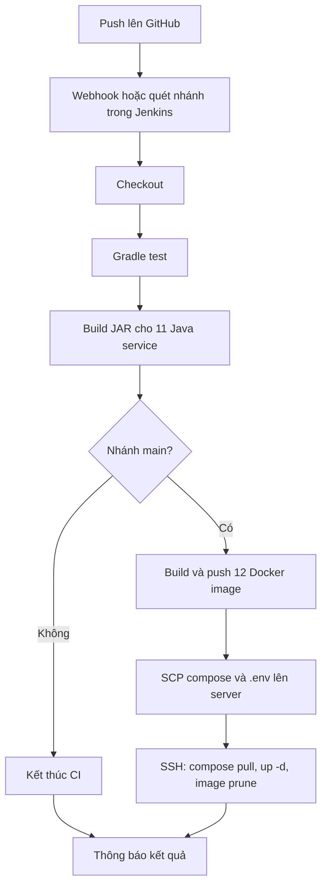

# CI/CD của nhánh main — Eatzy Microservices

Tài liệu đối chiếu trực tiếp với `Jenkinsfile`, `.github/workflows/cicd.yml`, Dockerfile và `docker-compose.prod.yml`.

## Vai trò của main

`main` là nhánh tích hợp và phát hành chính. Code design pattern và cấu hình Jenkins cùng tồn tại trên nhánh này.
Không cần quay về commit cũ hoặc bỏ các tính năng mới để thay đổi công cụ CI/CD.

## Ba nơi thực hiện công việc

| Nơi | Trách nhiệm |
|---|---|
| GitHub | Lưu source, nhánh, pull request và phát sự kiện khi có push |
| Jenkins agent | Checkout code, chạy Java/Gradle, kiểm thử, tạo JAR và Docker image |
| Server triển khai | Pull image từ Docker Hub và chạy container bằng Docker Compose |

Jenkins agent có thể chạy Windows hoặc Linux, không bắt buộc cùng máy với server triển khai.
Server vật lý vẫn là đích triển khai ở cả cách dùng Jenkins và cách dùng GitHub Actions.
Việc đổi công cụ CI/CD không yêu cầu đổi server.

## Luồng Jenkins hiện tại



Webhook, branch discovery, thông tin đăng nhập và SMTP được cấu hình ngoài source trên GitHub/Jenkins.
Chỉ đọc repository chưa chứng minh các thành phần này đã được bật hoặc server đang chạy đúng phiên bản.

| Nhánh được Jenkins theo dõi | Test | Build JAR | Build/push image | Deploy |
|---|---|---|---|---|
| main | Có | Có | Có | Có |
| feat/* và nhánh khác | Có | Có | Không | Không |

### 1. Checkout

Jenkins lấy commit của nhánh đang chạy. `BRANCH_NAME` hoặc `GIT_BRANCH` xác định tên nhánh.
Trên Unix, pipeline cấp quyền thực thi cho `gradlew`; Windows dùng `gradlew.bat`.

### 2. Test

- Unix: `./gradlew test --parallel --continue`.
- Windows: `gradlew.bat test --parallel --continue`.
- Gradle trả mã lỗi khi có test thất bại; Jenkins dừng các stage kế tiếp.
- `--continue` tiếp tục các task có thể chạy để thu thập thêm kết quả; không biến test thất bại thành thành công.
- JUnit XML luôn được thu thập ở cuối stage Test.
- Một số tài liệu cũ từng mô tả test thất bại vẫn deploy; đó không phải hành vi của Jenkinsfile hiện tại.

### 3. Build Java Artifacts

Gradle chạy task `bootJar` của 11 Java service. `-x test` tránh chạy lại test vì stage trước đã chạy.
Pipeline sao chép executable JAR vào `docker-artifacts/<service>.jar`.
Dockerfile Java chỉ lấy JAR có sẵn và đóng gói với Java 17 runtime; không tự compile source nữa.

### 4. Build và push image — chỉ main

Có 11 Java service và 1 Python AI service.
Mỗi image trên main có hai tag: `latest` và `main-<7 ký tự commit>`.
Unix build/push các service song song; Windows thực hiện tuần tự.
Image AI service cài Python dependencies theo Dockerfile riêng.
Các unit test Gradle hiện không kiểm thử hành vi Python AI service.

### 5. Deploy — chỉ main

Pipeline dùng SCP gửi `docker-compose.prod.yml` và file `.env` từ Jenkins Credentials tới:

```text
/home/<SSH_USER>/projects/eatzy-microservices
```

Sau đó SSH vào server và chạy:

```sh
export DOCKERHUB_USER=<tên tài khoản Docker Hub>
docker compose -f docker-compose.prod.yml pull
docker compose -f docker-compose.prod.yml up -d
docker image prune -f
```

Compose hiện tham chiếu image của các service bằng tag `latest`.
Tag `main-<commit>` có thể dùng để truy vết image, nhưng pipeline chưa có bước rollback tự động theo tag đó.
Các file được mount như `eatzy.jks` phải được chuẩn bị trên server; pipeline không gửi chúng trong stage Deploy.

`up -d` khởi động container ở chế độ nền. Pipeline chưa có bước smoke test sau deploy hoặc chờ toàn bộ service khỏe.
Jenkins báo thành công không đồng nghĩa toàn bộ API nghiệp vụ đã được kiểm thử trên server.

### 6. Kết thúc

Pipeline logout Docker và thử gửi email kết quả.
Push build gửi tới email tác giả commit; build chạy tay dùng thông tin người kích hoạt qua Jenkins plugin.
Nếu gửi mail lỗi, pipeline ghi log và không ném lại lỗi đó.

Các tùy chọn hiện tại: timeout 60 phút, không chạy đồng thời hai build của cùng pipeline job, giữ 10 build gần nhất.

## Credentials

Jenkins cần các ID sau; chỉ tên được lưu trong source:

| ID | Dùng cho |
|---|---|
| dockerhub-credentials | Đăng nhập Docker Hub để push image |
| server-ssh-key | SSH private key và user |
| server-ip | Địa chỉ server |
| server-port | Cổng SSH |
| dockerhub-user | Tên tài khoản image dùng khi deploy |
| env-file | File cấu hình môi trường gửi lên server |

GitHub access và SMTP/plugin email còn cần cấu hình trong Jenkins.
GitHub Actions dùng bộ secrets riêng trong GitHub, không tự lấy Jenkins Credentials.

## GitHub Actions hiện tại

Workflow vẫn tồn tại nhưng chỉ có `workflow_dispatch`: chạy tay, không tự chạy mỗi lần push main.
Code workflow chưa giới hạn việc chạy tay vào main, trong khi image vẫn gắn tag `latest` và bước deploy không có điều kiện nhánh.

Quan trọng: workflow này chưa được cập nhật theo Dockerfile mới.
Nó chạy Docker build nhưng chưa chạy Gradle tạo `docker-artifacts/*.jar`.
Trên runner sạch, build image Java sẽ thiếu file JAR. Vì thế hiện chưa thể coi đây là phương án dự phòng chạy ngay.

## Cách đổi công cụ mà vẫn dùng main

Hai công cụ có thể triển khai cùng code main lên cùng server vật lý.
Trước khi dùng lại GitHub Actions cần:

1. Thêm Java 17, chạy Gradle tests và build/copy 11 JAR trước Docker build.
2. Giới hạn publish/deploy ở main.
3. Chuẩn bị đầy đủ GitHub Secrets và file cấu hình môi trường trên server.
4. Tắt đường auto-deploy của Jenkins trước khi bật trigger push main của Actions.

Khi quay lại Jenkins: đưa Actions về chạy tay hoặc tắt deploy của workflow, rồi bật lại đường build main của Jenkins.

Đây là danh sách thay đổi cần thực hiện cho việc chuyển đổi, không phải bộ chọn provider đã được triển khai.
Không chạy hai đường deploy production đồng thời chỉ để thử chuyển đổi.

## Kiểm tra local và giới hạn

Chạy từ root repository bằng Java 17:

```powershell
.\gradlew.bat test --parallel --continue
```

Sau đó build các task bootJar tương ứng danh sách `javaServices()` trong Jenkinsfile.
Chạy test/build local không tự build/push image hay SSH vào server.

Các kiểm tra local không xác nhận Jenkins webhook, Docker Hub credentials, SSH, SMTP hoặc trạng thái ứng dụng trên server.
